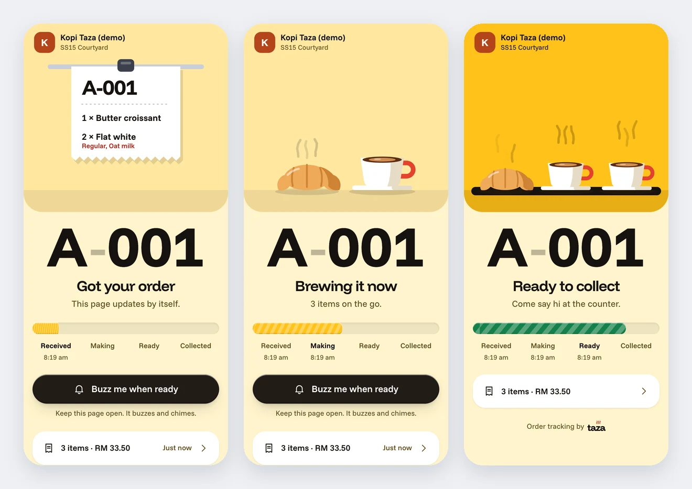
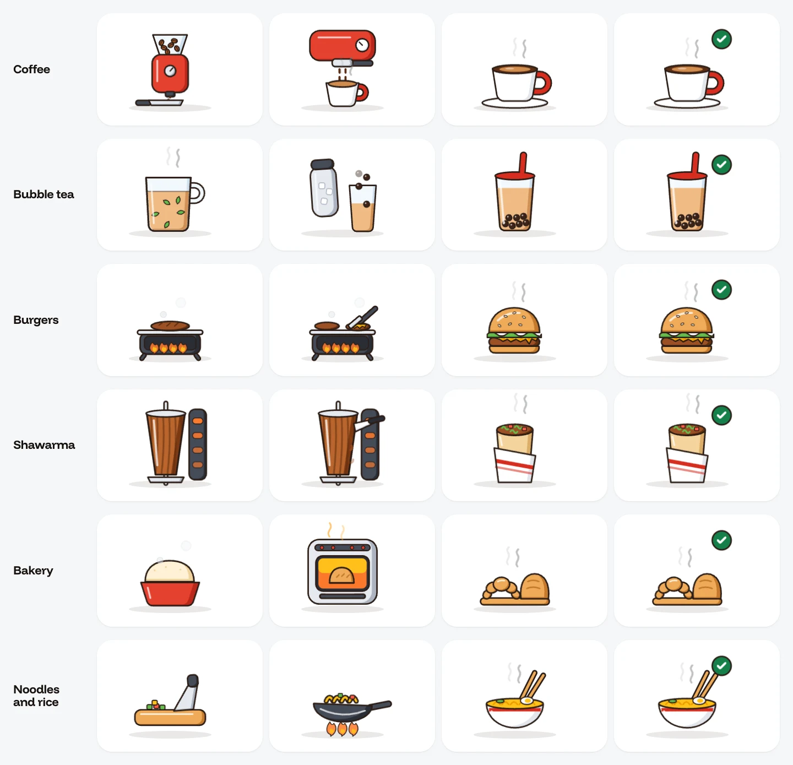
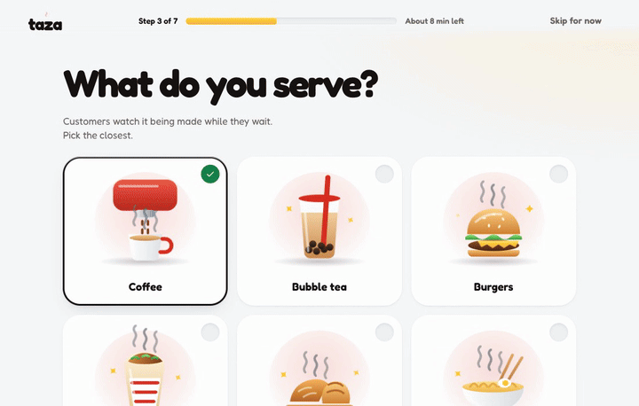
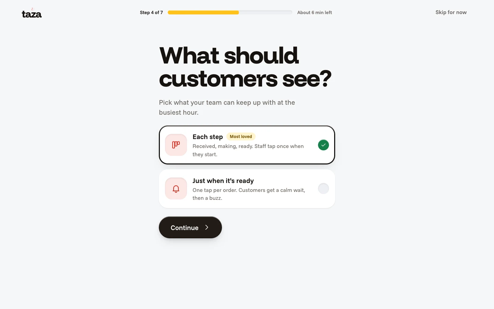
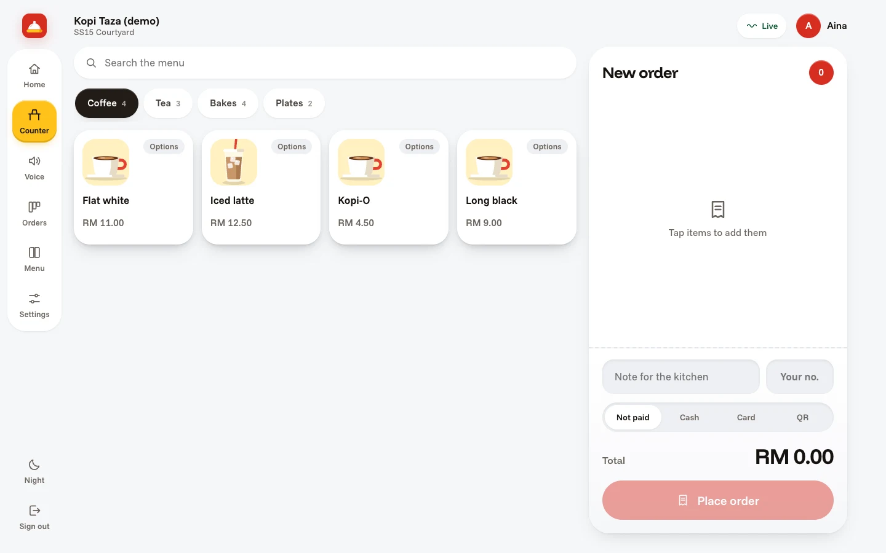
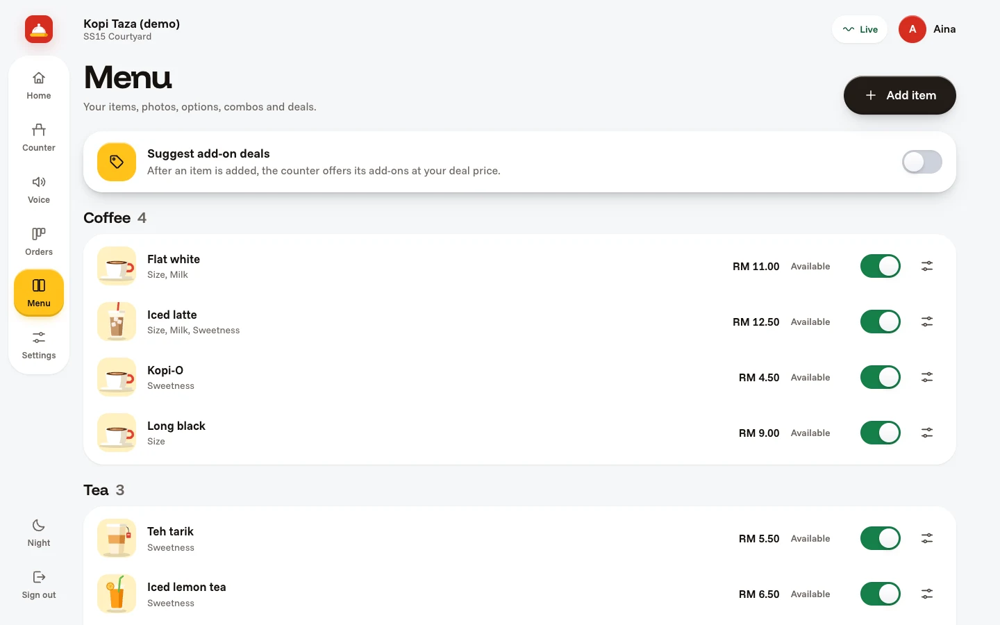

  <picture>
    <source media="(prefers-color-scheme: dark)" srcset="assets/brand/lockup-dark.png">
    
  </picture>

<b>Let them watch it get made.</b> Live order tracking for any food or drink counter. No app, no crowd at the pickup point.

Paused, not deployed. Runs end to end on a local stack. The source is private.

## What it does

Taza is the first module of a restaurant operating system: **Pickup Lite**.

- **Customers watch their own order.** They scan a QR, open a link or tap an NFC tag. First they see their paper ticket with the items they ordered. Then each item is built piece by piece. When it's ready, the whole order lands on a tray and the top of the page turns yellow, the same yellow the pickup TV uses.
- **The food is alive.** Every item is a small physical model on real springs. Press it and it squashes, drag it and the layers lean, let go and it wobbles back. Then it goes still, so phones stay cool. People who turn motion off get the finished picture.
- **26 foods so far, one recipe each.** Burgers, fries, wraps, fried chicken, pizza, sushi, dumplings, noodles, rice plates, soup, salad, coffee, tea, iced drinks, bubble tea, juice, pastries, cake, donuts and ice cream. Anything else shows as a paper bag. The menu uses the same pictures.
- **One screen, four things.** The order, the number, one bar and one button. Call, directions and saving the page sit inside order details. The screen stays awake while the order is on its way, because iPhones get no notifications from a web page.
- **Some places don't show the steps.** They can switch to "just when it's ready". Customers then see the same bar filled by honest time since ordering against the usual wait. It never fakes steps or fills up before staff tap Ready.
- **Staff can take orders by voice.** In capture mode the counter says the order out loud, Taza lists it against the menu, and staff tap Ready when it's done. Orders get a Taza number or keep the business's own POS number.
- **The business builds its own menu.** Photos, options ("no lettuce"), combos with a chosen drink, and discounted add-ons suggested after an item is added, if the owner switches that on.
- **Any business sets itself up.** It signs up from the website, says what it serves, chooses how much customers see, adds a few items, picks its look and sends itself a practice order.

## The customer page

| Ready-only mode, then collected | Dark surface |
|---|---|
|  |  |

## Every food on the menu

## Setting up a business

| Each step or just ready | Add your menu | Make the page yours |
|---|---|---|
|  |  |  |

## For staff

| Counter | Voice capture | Menu |
|---|---|---|
|  |  |  |

## Engineering

- **Backend:** .NET 10, ASP.NET Core minimal APIs as a modular monolith (organization, identity, entitlements, catalog, ordering, tracking, branding, NFC, board, onboarding). EF Core 10 on PostgreSQL 17. SignalR for the kitchen board, the customer page and the pickup display.
- **Correctness:** transactional outbox with a `FOR UPDATE SKIP LOCKED` dispatcher, idempotency keys on order creation, optimistic concurrency (two staff tapping the same order get a clear 409, not a 500). Combo and add-on prices are calculated on the server only.
- **Security:** tenant filters from claims, hashed 128-bit tracking tokens that expire, cookie auth with a CSRF header, rate limits on login, public and NFC routes, image byte sniffing on uploads, and a WCAG contrast guard on brand colours.
- **Web:** Vite + TypeScript with Preact behind `preact/compat`. The customer page ships **45.3 KB gzip** of JavaScript (budget 90 KB). The order scene is SVG driven by one small spring engine (fixed sub-steps, one ticker, paused off screen, stops when nothing moves); UI motion uses the same springs written into CSS `linear()` curves. Reduced motion is respected.
- **Tests (15 Nov 2026):** 57 unit, 16 integration against a real Postgres, 14 Playwright end-to-end on Chrome including axe accessibility checks, and 5 voice-parser tests. All passing.

## Status, honestly

- Built and tested locally: setup, counter, voice capture, menu builder, kitchen board, customer page, NFC hand-off.
- Not deployed. No businesses use it yet.
- The pickup TV gives Ready most of the screen, moves numbers that have waited over 5 minutes to a "ready a while ago" row instead of dropping them, and says the number out loud after the chime (English only so far).
- Still to do: kitchen stations in the Making stage (grill, espresso machine), a simpler setup flow, Bahasa Melayu and Chinese, and letting staff put any number on the TV (for example rider codes).
- Voice capture uses the browser's speech service and needs testing on real counter devices.

## Brand

A counter service bell for the symbol, the "it's ready" sound in any kitchen, and a "taza" wordmark with steam rising off the z. Red `#D62D20` and yellow `#FFC21A`. Titles and numbers are set in Funnel Display, everything else in Funnel Sans. The food art uses one drawing style everywhere: no outlines, flat colours and one shaded side, with no faces.

---

Screens and recordings are taken from the running app with Playwright; nothing is mocked up. The business names are demo data.
