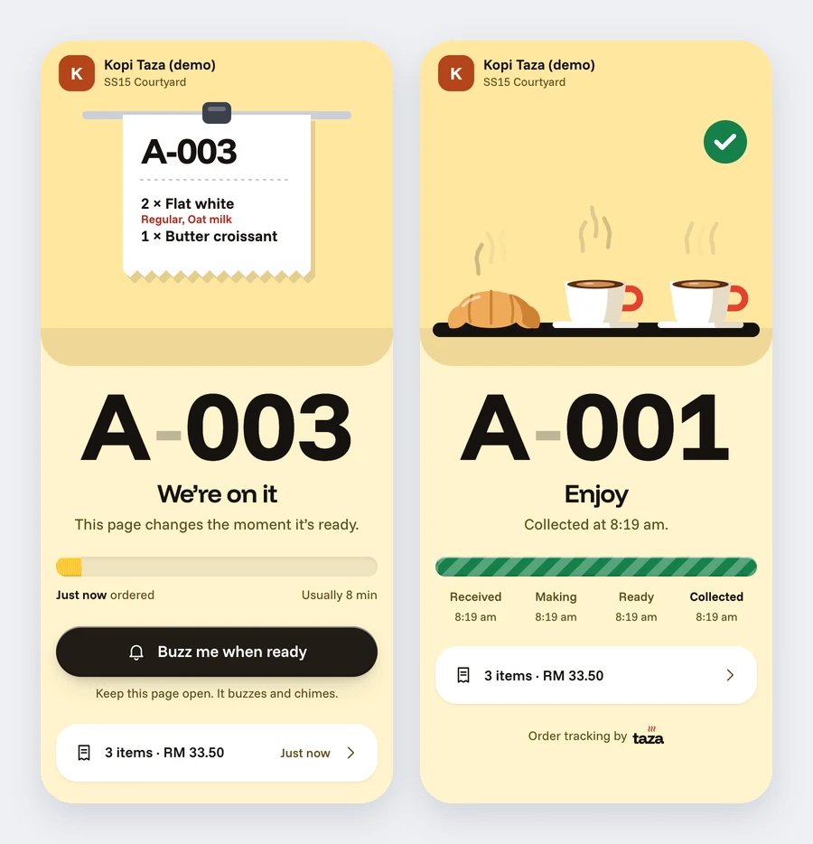
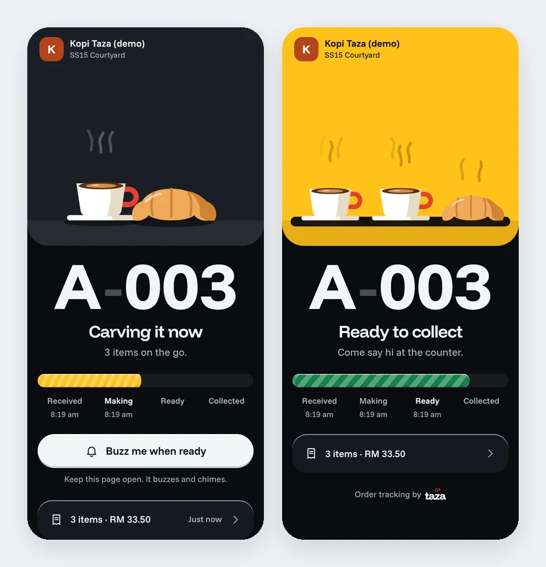
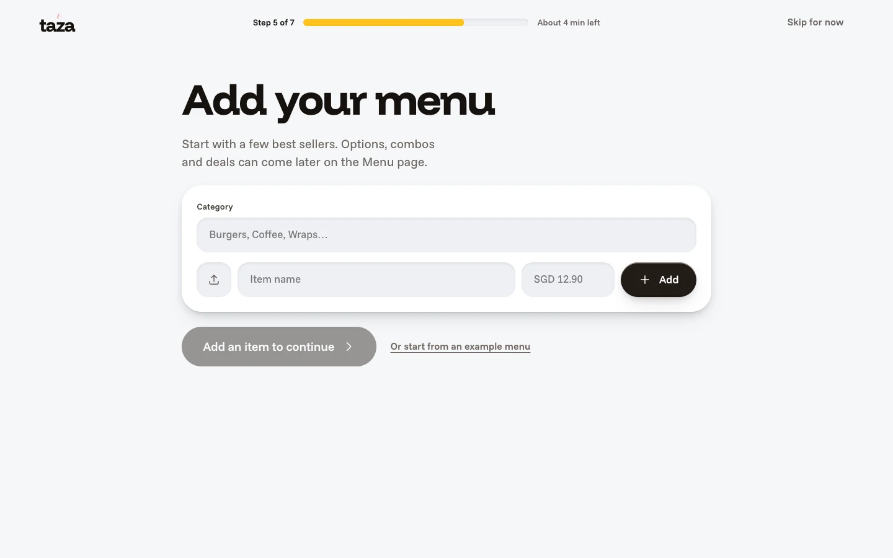
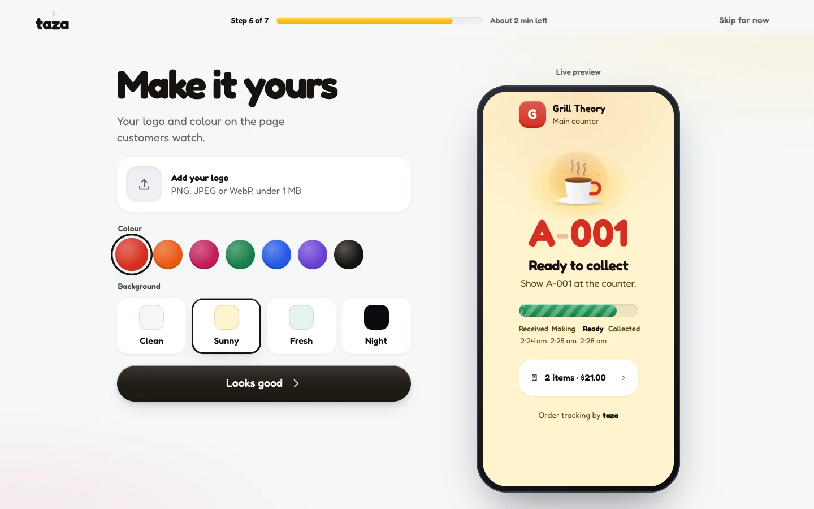
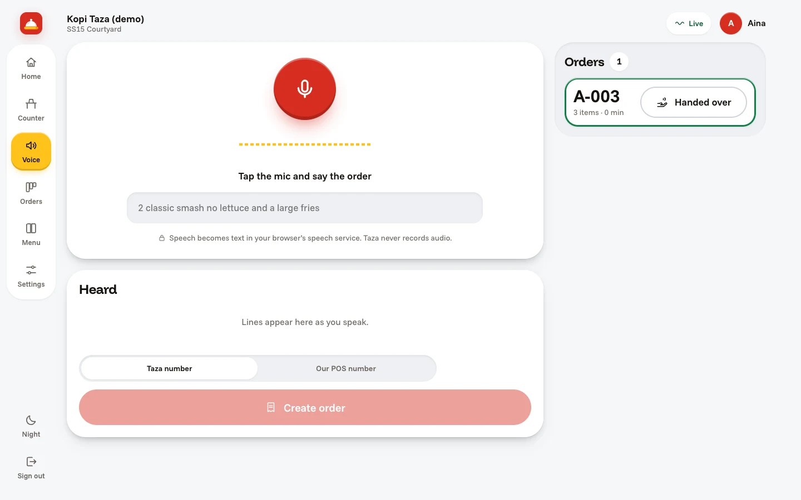

  <picture>
    <source media="(prefers-color-scheme: dark)" srcset="assets/brand/lockup-dark.png">
    
  </picture>

<b>Let them watch it get made.</b> Live order tracking for any food or drink counter. No app, no crowd at the pickup point.

Paused, not deployed. Runs end to end on a local stack. The source is private.

## What it does

Taza is the first module of a restaurant operating system: **Pickup Lite**.

- **Customers follow their order live.** They scan a QR, open a link or tap an NFC tag and get a big queue number, a scene of their food being made and a progress track that fills: Received, Making, Ready, Collected. The page can buzz them when it's ready, and it keeps working through a bad connection.
- **Each business type has its own scenes.** A burger place shows a patty on the grill, then the burger assembling. A shawarma place shows the spit being carved, then the wrap. Coffee, bubble tea, bakery, noodles and rice all have their own loops.
- **Some places don't show the steps.** They can switch to "just when it's ready". Customers then see honest time since ordering and a calm ring, never a fake progress bar.
- **Staff can take orders by voice.** In capture mode the counter says the order out loud, Taza lists it against the menu, and staff tap Ready when it's done. Orders get a Taza number or keep the business's own POS number.
- **The business builds its own menu.** Photos, options ("no lettuce"), combos with a chosen drink, and discounted add-ons suggested after an item is added, if the owner switches that on.
- **Any business sets itself up.** It signs up from the website, says what it serves, chooses how much customers see, adds a few items, picks its look and sends itself a practice order.

## The customer page

| Ready-only mode, then collected | Dark surface |
|---|---|
|  |  |

## Every kind of counter

## Setting up a business

| Each step or just ready | Add your menu | Make the page yours |
|---|---|---|
|  |  |  |

## For staff

| Counter | Voice capture | Menu |
|---|---|---|
|  |  |  |

## Engineering

- **Backend:** .NET 10, ASP.NET Core minimal APIs as a modular monolith (organization, identity, entitlements, catalog, ordering, tracking, branding, NFC, board, onboarding). EF Core 10 on PostgreSQL 17. SignalR for the kitchen board, the customer page and the pickup display.
- **Correctness:** transactional outbox with a `FOR UPDATE SKIP LOCKED` dispatcher, idempotency keys on order creation, optimistic concurrency (two staff tapping the same order get a clear 409, not a 500). Combo and add-on prices are calculated on the server only.
- **Security:** tenant filters from claims, hashed 128-bit tracking tokens that expire, cookie auth with a CSRF header, rate limits on login, public and NFC routes, image byte sniffing on uploads, and a WCAG contrast guard on brand colours.
- **Web:** Vite + TypeScript with Preact behind `preact/compat`. The customer page ships **39.9 KB gzip** of JavaScript (budget 90 KB). Spring motion is written into CSS `linear()` curves, scenes are SVG and CSS, and motion respects reduced-motion settings.
- **Tests (15 Nov 2026):** 57 unit, 16 integration against a real Postgres, 14 Playwright end-to-end on Chrome including axe accessibility checks, and 5 voice-parser tests. All passing.

## Status, honestly

- Built and tested locally: setup, counter, voice capture, menu builder, kitchen board, customer page, NFC hand-off.
- Not deployed. No businesses use it yet.
- Open polish items: dark-surface button contrast, "just now" wording under a minute, more scenes (pizza, desserts, juice, fried chicken, rice plates, sandwiches).
- Voice capture uses the browser's speech service and needs testing on real counter devices.

## Brand

A counter service bell for the symbol, the "it's ready" sound in any kitchen, and a soft "taza" wordmark with steam rising off the z. Red `#D62D20` and yellow `#FFC21A`, set in Fredoka.

---

Screens and recordings are taken from the running app with Playwright; nothing is mocked up. The business names are demo data.
